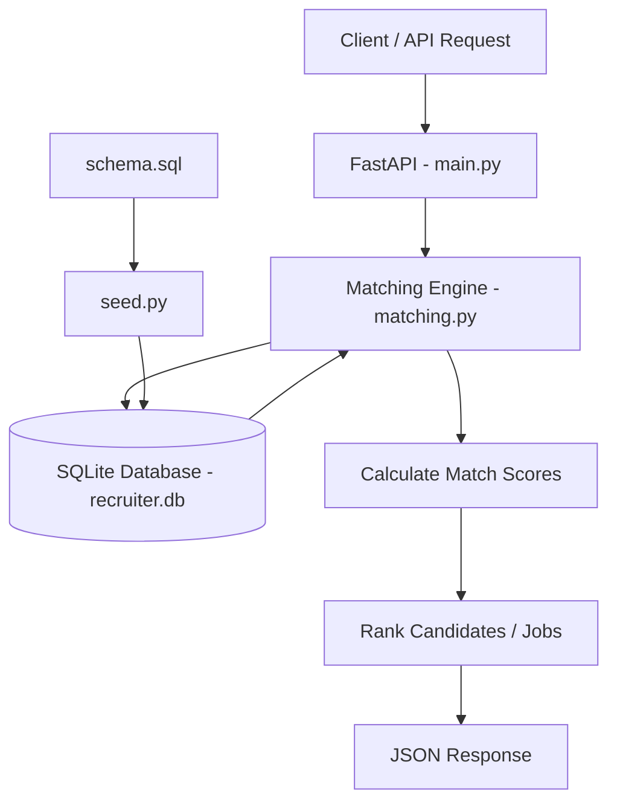

# Recruiter Bot – Candidate & Job Matching System

## 1. Project Overview

Recruiter Bot is a backend application developed using Python, FastAPI, and SQLite. It is designed to help recruiters identify suitable candidates for job postings and find relevant job opportunities for individual candidates.

The application uses a weighted matching algorithm to evaluate candidates against job requirements. Instead of relying on a single matching criterion, it considers skills, experience, candidate traits, and availability to calculate an overall match score.

The system supports matching in both directions:

- **Job → Candidates:** Given a job posting, rank available candidates based on their suitability.
- **Candidate → Jobs:** Given a candidate, rank available job postings based on their suitability.

Each match includes a score breakdown and a human-readable explanation, making the ranking easier to understand rather than returning just a numerical score.

The repository also includes the SQL Detective Challenge submission from Part 2.

## 2. Tech Stack

| Technology | Purpose |
|---|---|
| Python | Core programming language and matching logic |
| FastAPI | Building the REST API |
| SQLite | Storing candidate and job data |
| SQL | Database queries and SQL challenge |
| Pytest | Automated testing of matching logic |


## System Architecture

The Recruiter Bot follows a simple API-driven architecture. FastAPI handles incoming requests, the matching engine calculates and ranks matches, and SQLite stores the candidate and job data.




## 3. Project Structure

```text
recruiter-bot/
│
├── main.py                  # FastAPI application and API endpoints
├── matching.py              # Matching algorithm and ranking logic
├── schema.sql               # Database table definitions
├── seed.py                  # Database initialization and sample data
├── test_matching.py         # Automated tests for matching logic
│
├── requirements.txt         # Python dependencies
│
├── setup_sql_detective.py   # Creates and populates SQL challenge database
├── run_sql_detective.py     # Executes SQL challenge queries
├── sql_detective.sql        # SQL Detective Challenge submission
│
├── .gitignore
└── README.md
```

## 4. Installation and Setup

### Prerequisites

- Python 3
- Git
- pip (Python package installer)

### Step 1: Clone the repository

```bash
git clone https://github.com/GL-Anugnya/recruiter-bot
cd recruiter-bot
```

### Step 2: Create a virtual environment

```bash
python -m venv .venv
```

Activate it on Windows PowerShell:

```powershell
.venv\Scripts\Activate.ps1
```

### Step 3: Install dependencies

```bash
pip install -r requirements.txt
```

### Step 4: Initialize and seed the database

```bash
python seed.py
```

This script:

1. Connects to the SQLite database (`recruiter.db`).
2. Creates the required tables by executing the definitions in `schema.sql`.
3. Clears existing candidate and job records.
4. Inserts the sample candidate and job data.
5. Commits the changes and prints the inserted records for verification.

The database contains 15 sample candidates and 6 job postings.

**Note:** Running `seed.py` again resets the candidate and job records and repopulates them with the original sample data. This provides a consistent starting dataset for testing.

### Step 5: Start the application

```bash
uvicorn main:app --reload
```

The API will be available at:

`http://127.0.0.1:8000`

FastAPI's interactive API documentation is available at:

`http://127.0.0.1:8000/docs`

## 5. API Endpoints

The application exposes the following endpoints:

| HTTP Method | Endpoint | Description |
|---|---|---|
| GET | `/` | Returns a welcome message |
| GET | `/job/{job_id}/matches` | Returns ranked candidates for a given job |
| GET | `/candidate/{candidate_id}/matches` | Returns ranked jobs for a given candidate |

### Example API requests

**1. Get candidates for a job**

```bash
curl http://127.0.0.1:8000/job/1/matches
```

Returns candidates ranked by their match scores for Job ID 1.

**2. Get jobs for a candidate**

```bash
curl http://127.0.0.1:8000/candidate/1/matches
```

Returns job postings ranked by their suitability for Candidate ID 1.

**3. Check the application status**

```bash
curl http://127.0.0.1:8000/
```

Returns the welcome message from the application.

### Error Handling and Input Validation

The API handles invalid IDs and input formats.

| Test case | Example | Expected HTTP status |
|---|---|---|
| Existing job ID | `/job/1/matches` | 200 OK |
| Non-existent job ID | `/job/999/matches` | 404 Not Found |
| Existing candidate ID | `/candidate/1/matches` | 200 OK |
| Non-existent candidate ID | `/candidate/999/matches` | 404 Not Found |
| Non-integer job ID | `/job/abc/matches` | 422 Unprocessable Entity |

**How validation works:**

- If a valid integer ID does not exist in the database, the matching functions raise a `ValueError`, which is handled in `main.py` and returned as an HTTP 404 response.
- If the ID is not an integer, FastAPI automatically validates the path parameter before executing the endpoint function and returns HTTP 422.

### Testing through Swagger UI

The API can also be tested through FastAPI's interactive documentation:

1. Start the application.
2. Open `http://127.0.0.1:8000/docs`.
3. Expand the endpoint you want to test.
4. Click **Try it out**.
5. Enter the required ID and click **Execute**.
6. Inspect the response code and response body.

For example, entering `abc` in the `job_id` field produces a validation error because the endpoint expects an integer.

### Testing through curl

The endpoints can also be tested from a terminal while the server is running.

For Windows PowerShell, use `curl.exe`:

```powershell
# Successful request
curl.exe -i http://127.0.0.1:8000/job/1/matches

# Non-existent job ID
curl.exe -i http://127.0.0.1:8000/job/999/matches

# Invalid job ID format
curl.exe -i http://127.0.0.1:8000/job/abc/matches

# Non-existent candidate ID
curl.exe -i http://127.0.0.1:8000/candidate/999/matches
```

The `-i` option displays the HTTP response status and headers along with the response body.

These are manual API testing commands; they do not need to be implemented as functions in the Python application.

## 6. Matching Algorithm

The core matching logic is implemented in `matching.py`.

The algorithm calculates an overall match score using four components:

| Matching Component | Weight | Scoring Approach |
|---|---:|---|
| Skills | 50% | Percentage of required skills matched |
| Experience | 25% | 100 if minimum experience is met; otherwise 0 |
| Traits | 15% | Percentage of culture keywords matched |
| Availability | 10% | Based on predefined availability categories |

### How the scoring works

**1. Skill Matching (50%)**

Candidate skills and job-required skills are converted into sets. Their intersection gives the skills that match.

The score is calculated as:

`(Number of matched skills / Total required skills) × 100`

A candidate with no matching required skills is excluded from the results.

**2. Experience Matching (25%)**

The candidate's experience is compared against the minimum experience required by the job.

- Meets or exceeds the requirement: 100
- Falls below the requirement: 0

**3. Trait Matching (15%)**

Candidate traits are compared with the job's culture keywords using set intersection. The score represents the percentage of culture keywords matched.

If a job has no culture keywords, its trait score is set to 0.

**4. Availability Matching (10%)**

Availability is assigned predefined scores:

| Availability | Score |
|---|---:|
| Immediate | 100 |
| 2 weeks | 70 |
| Not looking | 20 |
| Other / Unknown | 0 |

### Overall Score

The weighted scores are combined to calculate the final match score:

`Final Score = (Skill Score × 0.50) + (Experience Score × 0.25) + (Trait Score × 0.15) + (Availability Score × 0.10)`

The default weights add up to 100%. Custom weights can also be passed to the matching functions, provided that their total is 100.

### Ranking and Explanations

After calculating the scores, the application ranks the matches in descending order.

When two or more matches have the same overall score, the following tie-breakers are applied in order:

1. Higher skill score.
2. Higher experience score.
3. Higher availability score.
4. Alphabetical order of candidate name or job title.

The algorithm also generates a human-readable explanation for each match. It highlights the matched skills, whether the experience requirement is met, matching culture keywords, and the candidate's availability.

## 7. Design Decisions and Trade-offs

A few important decisions were made while designing the matching algorithm.

**Prioritising skills**

Skills received the highest weight (50%) because technical and role-specific skills are important indicators of suitability. I also decided to make at least one matching required skill mandatory. This prevents a candidate with no relevant skills from being recommended simply because they have more experience or immediate availability.

The trade-off is that candidates with transferable skills or differently named but equivalent skills may be excluded.

**Using a binary experience score**

I chose a straightforward comparison against the minimum experience requirement. Candidates either meet the requirement or fall below it.

This keeps the scoring predictable and easy to understand. However, it does not differentiate between candidates who exceed the minimum experience requirement by different amounts.

**Using keyword-based trait matching**

Candidate traits and job culture keywords are compared using exact set intersection. This provides a simple and explainable way to evaluate alignment.

However, it does not capture synonyms or deeper contextual similarities between traits.

**Using predefined availability scores**

Availability is mapped to fixed scores to incorporate joining readiness into the ranking. This is simple to implement, although it does not account for more detailed notice periods or individual hiring timelines.

**Making the weights configurable**

Instead of hardcoding the weights throughout the algorithm, I allowed custom weights to be passed to the matching function. This makes it easier to adjust the importance of different criteria for different hiring priorities. The implementation also validates that the weights add up to 100.

**Ensuring deterministic ranking**

I added tie-breakers so that candidates or jobs with the same overall score are still returned in a consistent order. This makes the results predictable and easier to test.

Overall, I prioritised a matching approach that is transparent, deterministic, and easy to reason about rather than introducing more complex scoring mechanisms that would be harder to explain.

## 8. Testing

### Automated Tests

The matching logic is tested using Pytest.

Run the test suite using:

```bash
python -m pytest -v
```

The tests are implemented in `test_matching.py` and verify the matching logic and ranking behaviour.

### Manual API Testing

The API endpoints can be tested using:

- FastAPI's interactive Swagger documentation at `http://127.0.0.1:8000/docs`.
- `curl.exe` commands from a separate terminal.

Successful requests, non-existent IDs, and invalid ID formats can be tested to verify the API responses and input validation.

## 9. Part 2 – SQL Detective Challenge

The repository includes the SQL Detective Challenge submission in `sql_detective.sql`.

The challenge consists of five SQL queries covering joins, aggregation, data cleaning, conditional calculations, and window functions.

### Files

| File | Purpose |
|---|---|
| `sql_detective.sql` | Contains all five SQL challenge solutions. This is the main Part 2 submission. |
| `setup_sql_detective.py` | Creates and populates the separate SQLite database used by the challenge. |
| `run_sql_detective.py` | Reads and executes the queries directly from `sql_detective.sql`, displaying the results of each query. |

### Running the SQL challenge

First, initialize the challenge database:

```bash
python setup_sql_detective.py
```

Then execute all five queries:

```bash
python run_sql_detective.py
```

The execution script reads the SQL statements from `sql_detective.sql` and runs them individually against `sql_detective.db`. The results of each query are printed in the terminal.

The SQL Detective Challenge uses a separate database from the Recruiter Bot application.

## 10. AI Tool Usage

I used ChatGPT occasionally as a co-pilot during the assignment, mainly for clarification, debugging, and discussing a few implementation decisions.

I approached the assignment by first understanding the requirements and breaking the problems down before implementing them. I wrote and worked through the code myself in VS Code, step by step, rather than relying on AI-generated solutions.

For the Recruiter Bot, I independently worked through the matching logic, scoring components, ranking approach, and the decisions behind them. I used ChatGPT at certain points to clarify concepts, discuss possible approaches and trade-offs, understand specific parts of the implementation better, and troubleshoot errors when I encountered them.

For the SQL Detective challenge, I first examined the database schema and sample data to understand the tables and their relationships. I then went through each question, identified the SQL concepts and operations needed, such as joins, aggregation, filtering, and window functions, and worked out the query logic before writing the queries myself. I used AI assistance occasionally to clarify SQL behaviour, understand implementation details, and resolve errors.

I also used ChatGPT for some guidance on structuring and formatting the documentation. Overall, I treated it as a supporting tool when needed, while taking responsibility for understanding, writing, and testing my implementation.
